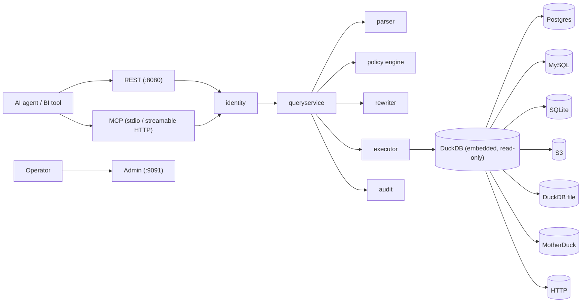

<!-- SPDX-License-Identifier: CC-BY-4.0 -->

# Architecture

Sluice stands between your clients and your data sources. For each query it checks your policies, rewrites the SQL so that only allowed rows and columns come back, and writes an audit record.

## Component map

- REST and MCP use the same pipeline, so both give the same decision. See [Request lifecycle](request-lifecycle.md).
- The engine decides on each query. See [Policy engines](policy-engines.md).
- An embedded DuckDB runs the rewritten SQL. Each data source is a catalog in it, so one query can join tables from several [data sources](../operations/data-sources.md).

## Rules you can rely on

- **Default deny.** Sluice denies a query unless a policy allows every table that the query reads. An empty policy directory denies every query.
- **Audit before rows.** By default Sluice queues the audit record before it sends the first row. If it cannot, the query fails with `ERR_AUDIT_UNAVAILABLE`. See [Audit log](../security/audit.md).
- **No writes.** Sluice runs `SELECT` and `EXPLAIN`. It refuses writes, DDL, `SET` and `SHOW`. See [Statements Sluice runs](request-lifecycle.md#statements-sluice-runs).
- **Bound parameters.** Row filter values reach DuckDB as bound parameters, not as SQL text. A value from a policy cannot change the statement.
- **Reload without restart.** Sluice loads changed policies after a file change, a `SIGHUP` or `POST /admin/reload`. If the new policies have an error, the old ones stay active. See [Reload](../operations/hot-reload.md).
