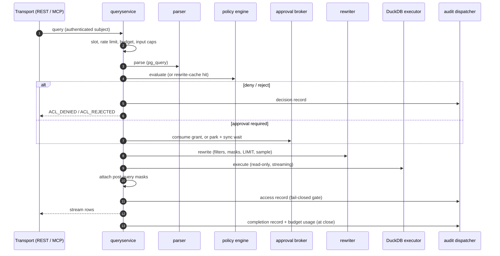

<!-- SPDX-License-Identifier: CC-BY-4.0 -->

# Request lifecycle

Every query passes the same stages, over REST and over MCP. Each stage can stop the request with an [error code](../reference/error-codes.md).



Diagram numbers count messages, not stages.

## Stages

1. **Transport limits and login.** The REST API checks its rate limits. Sluice maps the API key or token to a subject.
2. **Admission.** Sluice checks the concurrency limit, the subject's [rate limit and budget](../policies/subjects.md) and the SQL size. It caps the requested timeout and row count.
3. **Parse.** Sluice parses the statement with the PostgreSQL grammar and finds its tables.
4. **Statement checks.** Sluice checks function calls and table names.
5. **Policy.** The [engine](policy-engines.md) allows, denies or rejects the query.
6. **Approval.** An [approval policy](../policies/approvals.md) can hold the query until a person accepts it.
7. **Rewrite.** Sluice refuses writes and DDL. It adds [row filters](../policies/row-filters.md), [column masks](../policies/column-masks.md) and [limits](../policies/guardrails.md) to the SQL.
8. **Execute.** DuckDB runs the rewritten SQL.
9. **Post-query masks.** Some mask types change values in the result rows.
10. **Audit, then rows.** Sluice queues the [audit record](../security/audit.md), then sends the rows.
11. **Close.** Sluice writes a second audit record with the row count and updates the budget.

## Example

Goal: see which stage stops a request. One policy allows the group `analytics` to read `shop.main.customers`.

```yaml
--8<-- "examples/request-lifecycle/policies.d/allow-customers.yaml:2"
```

No policy allows `shop.main.payroll`. The policy stage denies the query:

```bash
--8<-- "examples/request-lifecycle/steps/05-denied-table.sh"
```

```json
--8<-- "examples/request-lifecycle/expected/05-denied-table.txt"
```

A write on the allowed table passes the policy stage. The rewrite stage rejects it:

```bash
--8<-- "examples/request-lifecycle/steps/06-write.sh"
```

```json
--8<-- "examples/request-lifecycle/expected/06-write.txt"
```

A typing error gives a parse error:

```bash
--8<-- "examples/request-lifecycle/steps/02-parse-error.sh"
```

```json
--8<-- "examples/request-lifecycle/expected/02-parse-error.txt"
```

What happened: each request stopped at a different stage. Several stages share the code `ACL_REJECTED`.

## Statements Sluice runs

| Statement | Result |
|---|---|
| `SELECT` | Runs |
| `EXPLAIN` of a `SELECT` | Runs. `ERR_UNSUPPORTED_SYNTAX` if a row filter or column mask applies |
| `INSERT`, `UPDATE`, `DELETE`, also inside a `WITH` | `ACL_REJECTED` |
| DDL, `COPY`, `SELECT ... INTO`, `SET`, `RESET`, `SHOW` | `ERR_UNSUPPORTED_SYNTAX` |
| `ATTACH` | `ERR_SYNTAX` |

Policies see no table in `SET` and `SHOW`. An allow policy that names a table does not match them, so the answer is `ACL_DENIED`. The code in the table shows under an allow policy without `resources`.

## Where a request stops

| Stage | What stops the request | Error code |
|---|---|---|
| Transport limits | `limits.globalRps` or `limits.perIpRps` reached | `ERR_RATE_LIMITED` |
| Login | No valid API key or token | `ERR_UNAUTHORIZED` |
| Admission | `limits.maxConcurrent` or subject rate limit reached | `ERR_RATE_LIMITED` |
| | Daily budget used up | `ERR_BUDGET_EXCEEDED` |
| | SQL over `limits.maxSqlBytes` | `ERR_PAYLOAD_TOO_LARGE` |
| Parse | Parser cannot read the statement | `ERR_SYNTAX` |
| | Two statements in one request | `ERR_MULTIPLE_STATEMENTS` |
| | Identifier over 63 bytes, nesting too deep | `ERR_UNSUPPORTED_SYNTAX` |
| Statement checks | Function not on the allow list, or written as `schema.f(x)` or `x.f()` | `ACL_REJECTED` |
| | Function in `FROM` other than `generate_series`, `range`, `unnest` | `ACL_REJECTED` |
| | `TABLESAMPLE` | `ACL_REJECTED` |
| | Table name with `/`, `\`, `:`, `*`, `?` or `[` | `ACL_REJECTED` |
| | Table written as `catalog.table` | `ACL_REJECTED` |
| | Second catalog with `limits.disableCrossCatalog` | `ACL_REJECTED` |
| | Parameter such as `$1` | `ERR_UNSUPPORTED_SYNTAX` |
| Policy | No allow, or a deny policy | `ACL_DENIED` or the policy's code |
| | Reject rule | `ACL_REJECTED` or the rule's code |
| | Engine error | `ERR_POLICY_UNAVAILABLE`, `ERR_TIMEOUT` |
| Approval | Waiting for a person | `ERR_APPROVAL_PENDING` |
| | Rejected or expired | `ERR_APPROVAL_REJECTED`, `ERR_APPROVAL_EXPIRED` |
| | Queue full | `ERR_RATE_LIMITED` |
| | `ApprovalPolicy` added by a reload, `approval.publicBaseUrl` not set | `ERR_INTERNAL` |
| Rewrite | Write statement | `ACL_REJECTED` |
| | DDL, `COPY`, `SET`, `RESET`, `SHOW` | `ERR_UNSUPPORTED_SYNTAX` |
| | [Form refused on a filtered or masked table](../policies/row-filters.md#sql-forms-refused-on-filtered-or-masked-tables) | `ERR_UNSUPPORTED_SYNTAX`, `ERR_SYNTAX`, `ERR_MASK_UNSUPPORTED_CONTEXT` |
| | Masked table missing in the schema cache | `ERR_REWRITE_FAILED` |
| | Schema cannot be loaded | `ERR_DATASOURCE_UNAVAILABLE` |
| | Template value the subject lacks | `ACL_DENIED` |
| | Statement too large for the DuckDB parse check | `ERR_PAYLOAD_TOO_LARGE` |
| Rewrite or execute | Timeout, client gone | `ERR_TIMEOUT`, `ERR_CANCELED` |
| Execute | DuckDB refuses the statement | `ERR_QUERY_FAILED` |
| | Data source not reachable | `ERR_DATASOURCE_UNAVAILABLE` |
| | Other error | `ERR_INTERNAL` |
| Post-query masks | Result columns do not match, mask cannot be built | `ERR_MASK_UNSUPPORTED_CONTEXT`, `ERR_INTERNAL` |
| Audit | Audit queue full | `ERR_AUDIT_UNAVAILABLE` |

## Limits

- Parse and rewrite errors show only if the policies allow the statement. A deny or reject comes first.
- `ERR_SYNTAX` also covers a table alias that is a DuckDB keyword and an unquoted identifier with a non-letter Unicode character.
- A request stopped by the transport limits, the login or `limits.maxConcurrent` leaves no audit record.
- With `cache.rewrite.enabled`, a cached rewrite keeps the old column list of a masked table until `cache.rewrite.ttl` ends or a reload.

## See also

- [Error codes](../reference/error-codes.md)
- [Policy engines](policy-engines.md)
- [Audit log](../security/audit.md)
