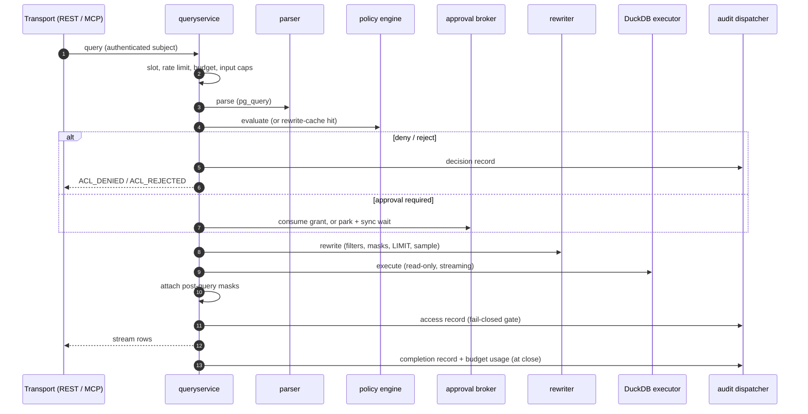

<!-- SPDX-License-Identifier: CC-BY-4.0 -->

# Request lifecycle

Every query — REST or MCP — runs the same pipeline in `internal/queryservice`; the admin plane's
explain simulation reuses the same policy-evaluation path without executing.
Each stage can terminate the request with a typed error code; anything that survives all gates
streams rows back to the client and leaves a hash-chained audit trail.

## Admission

0. **Transport buckets.** Before identity resolution, `limits.globalRps` bounds all `/v1/query`
   traffic and `limits.perIpRps` (optional) bounds each remote IP; over either is a 429
   `ERR_RATE_LIMITED` that never reaches the identity layer.
1. **Concurrency slot.** `limits.maxConcurrent` caps in-flight requests; a saturated service
   returns `ERR_RATE_LIMITED` after a short grace wait.
2. **Per-subject rate limit.** A token bucket keyed on the subject (falling back to the issuer,
   then to `limits.defaultSubjectRps`) enforces the SubjectBinding's `rateLimit{rps, burst}`;
   over the limit is `ERR_RATE_LIMITED`.
3. **Daily budget.** If budgets are enabled, the subject's CPU-seconds and rows-served ledger is
   checked before any work; an exhausted budget returns `ERR_BUDGET_EXCEEDED`.
4. **Input caps.** SQL larger than `limits.maxSqlBytes` returns `ERR_PAYLOAD_TOO_LARGE`. The
   requested timeout and row count are clamped to the configured ceilings — tightened, never
   rejected.

## Parse

The statement is parsed with pg_query, the real PostgreSQL grammar. An unquoted identifier that
contains a non-letter Unicode character (for example a no-break space) is a parse error, because
DuckDB would split it into different tokens than pg_query does. If parsing fails, a regex
fallback still extracts table names so policy can evaluate — and deny — the request. A parse error
(`ERR_SYNTAX`, `ERR_MULTIPLE_STATEMENTS`, `ERR_UNSUPPORTED_SYNTAX`) is only surfaced when policy
would otherwise have allowed the query: a deny or reject always takes precedence, so a caller
cannot use syntax probing to map what they are denied.

An identifier longer than 63 bytes (a quoted name counts after decoding, the content of a
`U&"..."` name as written) is a parse error with `ERR_UNSUPPORTED_SYNTAX`. pg_query cuts such a
name to 63 bytes and DuckDB does not, so policy would match another name than the one DuckDB
reads.

A `FROM` alias that DuckDB reads as a keyword (`semi`, `anti`, `asof`, `positional`, `qualify`,
`by`, `pivot`, `show` and more) is a parse error with `ERR_SYNTAX`. pg_query writes the alias
bare, and DuckDB would read the keyword: a join keyword changes the join type, and
`generate_series(1, 1) AS qualify(x)` becomes `QUALIFY (x)`, a row filter on the raw value of
`x`. Use another alias.

## Function gate

A cleanly parsed statement is checked for function calls before the rewrite cache and before
policy evaluation. A call that is not on the built-in allowlist, a `FROM` function with a column
or subquery argument, a qualified function name (`schema.f(x)` or the method form `x.f()`), a
table name that contains path characters (`/ \ : * ? [`), or a `FROM` item other than a table,
subquery, join, or function (`TABLESAMPLE`, `XMLTABLE`, `JSON_TABLE`) terminates with
`ACL_REJECTED`. The request is audited with decision `reject` and no applied policies. See
[Security model](security-model.md). A statement with a `$n` parameter terminates with
`ERR_UNSUPPORTED_SYNTAX` ("query parameters ($n) are not supported") and is audited with decision
`error`: caller params are not bound, and `$n` would read the values the rewriter binds.

## Policy evaluation

The configured engine (see [Policy engines](policy-engines.md)) produces a decision: outcome, row
filters, column masks, rewrite effects, rejections, and any approval requirement.

- **Rewrite cache.** With `cache.rewrite.enabled: true`, the (decision, rewrite) pair is memoised
  in an LRU cache. The key binds the active snapshot's version and digest, a hash of the raw SQL
  text, and a hash of the caller's identity — so a policy reload, a different query, or a different
  subject can never hit a stale entry. Only cleanly parsed queries are cacheable, and rate limits,
  budgets, approvals, and audit still run on every request.
- **Enforcement mode.** Only `enforcementMode: Enforce` policies (the default) shape the decision.
  `Audit` and `DryRun` policies are evaluated and recorded as shadow entries in the decision and
  audit record, but change nothing.
- **Short-circuit.** A deny terminates with `ACL_DENIED` (message and code from the
  highest-priority deny policy); a fired reject rule terminates with `ACL_REJECTED` or the rule's
  custom code.

## Approval gate

If the decision requires human approval, the service first tries to consume an existing single-use
grant for this subject and exact SQL hash — a granted re-run proceeds directly. Otherwise the
request is parked with the broker (the admission slot is released first), webhooks fire, and the
service waits up to `approval.syncWait` (default 20 s, bounded by the request deadline). Approval
within the window re-runs the pipeline once, consuming the grant. Otherwise the caller gets
`ERR_APPROVAL_PENDING` (HTTP 202) with the approval id; a rejection returns
`ERR_APPROVAL_REJECTED`, an expiry `ERR_APPROVAL_EXPIRED`. A full broker fails closed with
`ERR_RATE_LIMITED`. Details in [Approvals](../policies/approvals.md).

## Rewrite

The rewriter applies the decision to the AST, in every `SELECT` of the statement including
subqueries inside expressions: `SELECT *` is expanded against the schema cache; row
filters are injected by wrapping the table in a subquery whose `WHERE` predicate uses bound `$N`
parameters (values are never spliced into SQL text); column masks replace the column references; a `LIMIT` is injected when absent and a constant `LIMIT` above the cap is clamped; a sampling
instruction wraps the statement in `SELECT * FROM (<sql>) AS sluice_sample USING SAMPLE <r>%
(<method>)`. Only `SELECT`, `EXPLAIN`, `SET`, `SHOW`, and `PRAGMA` are allowed:
`INSERT`/`UPDATE`/`DELETE` return `ACL_REJECTED`, and DDL/`COPY`/`ATTACH` return
`ERR_UNSUPPORTED_SYNTAX`. A `QueryRewritePolicy` timeout or row cap tightens the request-level
clamps from admission — it never loosens them.

An `EXPLAIN` is refused with `ERR_UNSUPPORTED_SYNTAX` when a row filter or column mask applies,
because the plan would show the policy SQL with its bound values. A filtered table without an
alias whose name DuckDB reads as a keyword (`semi`, `by`, `qualify`, ...) is refused with
`ERR_UNSUPPORTED_SYNTAX`. Give such a table an alias.

pg_query deparses for PostgreSQL, and DuckDB runs the deparsed text. So on a `SELECT` that a row
filter, column mask, limit or sample applies to, the rewriter first writes a few forms the way
DuckDB reads them (`LIKE ... ESCAPE`, `INTERVAL 'n' <unit>`, casts to `json` and `bit`, a bare
`FLOAT`, the letter case of aliases and of `EXTRACT` units). Then, before it adds any policy SQL,
it asks a separate DuckDB instance (one thread, two connections, nothing attached, memory sized
from `limits.maxSqlBytes`) to parse the caller's text and the deparsed text, and compares the two
trees. When they differ, the query is refused with `ERR_UNSUPPORTED_SYNTAX`;
when DuckDB cannot parse the caller's text, with `ERR_SYNTAX`. The forms and what to write instead
are listed in
[Row filters](../policies/row-filters.md#sql-forms-refused-on-filtered-or-masked-tables). A failed
check is `ERR_INTERNAL`, a statement too large for the check is `ERR_PAYLOAD_TOO_LARGE`, and a
request canceled or timed out during the check gets `ERR_CANCELED` or `ERR_TIMEOUT`. A mask snippet from a `pkg/mask` provider gets the same check once per distinct
text. A pass-through query is not deparsed, so it is not checked. A column qualified with the
schema or catalog of a filtered table without an alias (`main.orders.id`) is refused with
`ERR_UNSUPPORTED_SYNTAX`, because the wrapper is named after the table alone.

## Execute

The rewritten SQL runs on embedded DuckDB against read-only attached catalogs, streaming rows
through an iterator. The timeout is enforced by the service context (not injected into SQL) and
maps to `ERR_TIMEOUT`; a client disconnect maps to `ERR_CANCELED`.

## Post-query masks

Masks of type `hash` with `algorithm: hmac_sha256`, `fpe`, `jitter`, and `fake` are applied in Go
to the result rows rather than rewritten into SQL: they need keyed cryptography or deterministic
fake-data generation that cannot be expressed as a portable SQL expression. The mask decorators are
built *before* the audit gate, so a construction failure (for example an unresolvable key
reference) refuses the query with nothing served. The masks are bound by column position, so the
service first checks that the result has the column count and, at each masked position, the
column name the rewriter planned. A mismatch refuses the query with `ERR_MASK_UNSUPPORTED_CONTEXT`.

## Audit gate and streaming

Before the first row reaches the caller, the access record must be durably enqueued with the audit
dispatcher. If it cannot be — queue full past the enqueue deadline — the query is refused with
`ERR_AUDIT_UNAVAILABLE` and no rows are served. This is the default (`audit.failClosed: true`);
setting it to `false` logs the failure and serves the query anyway. Closing the row iterator emits
a best-effort completion record carrying the final row count and records budget usage (execution
CPU time and rows served; client streaming time is deliberately excluded).

## Terminating error codes by stage

| Stage | Codes |
| --- | --- |
| Concurrency slot | `ERR_RATE_LIMITED` |
| Rate limit | `ERR_RATE_LIMITED` |
| Budget | `ERR_BUDGET_EXCEEDED` |
| Input caps | `ERR_PAYLOAD_TOO_LARGE` |
| Parse | `ERR_SYNTAX`, `ERR_MULTIPLE_STATEMENTS`, `ERR_UNSUPPORTED_SYNTAX` (surfaced only on allow) |
| Function gate | `ACL_REJECTED`, `ERR_UNSUPPORTED_SYNTAX` (`$n` parameters) |
| Policy | `ACL_DENIED`, `ACL_REJECTED` (or a policy's custom code) |
| Approval | `ERR_APPROVAL_PENDING`, `ERR_APPROVAL_REJECTED`, `ERR_APPROVAL_EXPIRED`, `ERR_RATE_LIMITED` (broker full) |
| Rewrite | `ACL_REJECTED` (writes), `ERR_UNSUPPORTED_SYNTAX`, `ERR_SYNTAX` (DuckDB cannot parse the statement), `ERR_REWRITE_FAILED`, `ERR_MASK_UNSUPPORTED_CONTEXT`, `ERR_TIMEOUT`, `ERR_CANCELED`, `ERR_PAYLOAD_TOO_LARGE` and `ERR_INTERNAL` (DuckDB parse check) |
| Execute | `ERR_TIMEOUT`, `ERR_CANCELED`, `ERR_INTERNAL` |
| Post-query masks | `ERR_MASK_UNSUPPORTED_CONTEXT`, `ERR_INTERNAL` |
| Audit gate | `ERR_AUDIT_UNAVAILABLE` |

The full catalog, with HTTP status mappings, is in [Error codes](../reference/error-codes.md).
