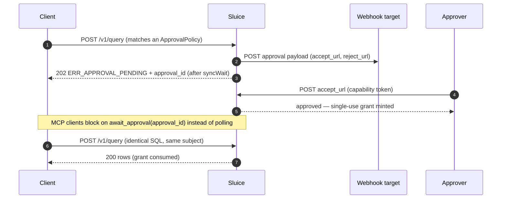

<!-- SPDX-License-Identifier: CC-BY-4.0 -->

# Approvals

An `ApprovalPolicy` holds an allowed query until a person, the approver, accepts it.

## Example

Goal: a query that names `ssn` or a salary column waits for an approver.

```yaml
--8<-- "examples/approval-workflow/policies.d/approval.yaml:approval"
```

Alice asks for `ssn`. Sluice holds the query and answers with status 202.

```bash
--8<-- "examples/approval-workflow/steps/01-query-held.sh"
```

```json
--8<-- "examples/approval-workflow/expected/01-query-held.txt"
```

Sluice posts a webhook to each URL in `approval.webhooks`. The example stores it:

```bash
--8<-- "examples/approval-workflow/steps/02-webhook.sh"
```

```json
--8<-- "examples/approval-workflow/expected/02-webhook.txt"
```

The approver opens `accept_url` in a browser and confirms on the page. A script sends a `POST`:

```bash
--8<-- "examples/approval-workflow/steps/03-accept.sh"
```

```json
--8<-- "examples/approval-workflow/expected/03-accept.txt"
```

Alice sends the same query again.

```bash
--8<-- "examples/approval-workflow/steps/04-query-runs.sh"
```

```json
--8<-- "examples/approval-workflow/expected/04-query-runs.txt"
```

**What happened:** The accept created a grant. A grant lets the same subject run the identical SQL text once. The next run is held again.



## Fields

| Field | Type | Default | Meaning |
|---|---|---|---|
| `when` | object | | One hit is enough. Without it, the selector alone decides. |
| `when.columnsAccessed` | list | | Patterns for columns that the query reads, as `ssn` or as `p.ssn`. |
| `when.predicates[]` | list | | A hit is a comparison of the column with a literal. |
| `predicates[].column` | string | required | Pattern. |
| `predicates[].op` | string | any | `=`, `!=`, `<`, `<=`, `>`, `>=`, `like`, `ilike`, `in` or `isnull`. `*` also means any. `=` also matches a value in an `IN` list. |
| `predicates[].value` | string | any | The literal as text. |
| `reason` | string | | Text for `reasons` in the webhook. |

`columnsAccessed` holds every query that reads the column. Names match without regard to case. A pattern matches each part of a dotted name: `ssn` hits `p.ssn`, and `profile` hits the field `profile.city`. A query that reads columns of a table without naming them hits every entry. These forms do that:

- `*` and `t.*` over a table. A star over a subquery or CTE that names its columns is no hit.
- the table, its alias or a join alias as a value: `SELECT p FROM people p`. A column named like a table of the query counts as such a value.
- a column alias list on a table or a join: `people p(a, b)`
- a position: `#2`
- `NATURAL JOIN`

`predicates` look at the conditions that name the column. Sluice reads a comparison of the column with a literal in `WHERE`, `HAVING`, `JOIN ... ON` or `FILTER`. `AND` and `OR` can join such comparisons. A number also matches in another spelling: `7` hits `7.0`. Any other condition that names the column is a hit, whatever `op` and `value` say. Examples are a function around the column, a cast of the literal, `NOT`, `NOT IN`, `CASE`, `BETWEEN`, a subquery, another column and `USING`.

With `enforcementMode: Audit`, Sluice holds nothing. `sluice policy explain --json` lists the policy under `shadow`, and the audit record under `policies_shadow`.

## Server config

```yaml
--8<-- "examples/approval-workflow/server.yaml:approval"
```

| Key | Default | Meaning |
|---|---|---|
| `approval.publicBaseUrl` | | Base URL of the accept and reject links. Without it, Sluice does not start with an `ApprovalPolicy`. |
| `approval.webhooks[].headersRef` | | Secret with a JSON map of headers. |
| `approval.webhooks[].timeout` | 10s | Timeout of one try. At most 10s. |
| `approval.syncWait` | 20s | Wait before the 202. At most `rest.requestTimeout` minus 2 seconds. |
| `approval.requestTtl` | 15m | Life of a pending approval. |
| `approval.grantTtl` | 5m | Life of a grant. |
| `approval.maxPending` | 1000 | Maximum pending approvals. A further query gets 429 `ERR_RATE_LIMITED`. |
| `approval.sqlSampleBytes` | 2048 | Longest `sql` in the webhook. 0 sends none. |
| `approval.persist` | `false` | Keeps approvals, grants and links in `approval.stateDir`. |

Sluice tries each webhook 3 times. A failed delivery is logged and does not fail the query.

## What the client sees

| Situation | Status | Answer |
|---|---|---|
| No decision within `syncWait` | 202 | `ERR_APPROVAL_PENDING` |
| Accept within `syncWait` | 200 | Rows |
| Reject within `syncWait` | 403 | `ERR_APPROVAL_REJECTED` |
| The approval expires within `syncWait` | 410 | `ERR_APPROVAL_EXPIRED` |
| Same query, approval still pending | 202 | `ERR_APPROVAL_PENDING`, same id, no new webhook |
| Run after a reject or an expired grant | 202 | `ERR_APPROVAL_PENDING`, new id |

The subject that asked reads the state with `GET /v1/approvals/{id}`. Other subjects get 404. States: `pending`, `approved`, `rejected`, `expired`, `consumed`. After a reject:

```bash
--8<-- "examples/approval-workflow/steps/07-status.sh"
```

```json
--8<-- "examples/approval-workflow/expected/07-status.txt"
```

MCP clients use `check_approval` and `await_approval`. The operator lists pending approvals with `GET /admin/approvals`. The [audit log](../security/audit.md) records each approval, decision and expiry.

## Limits

- A `predicates` entry is no guard for the column. It misses a condition on another name for the column: an alias, a column of a subquery or CTE, a position, a `NATURAL JOIN`. It misses another operator with the same result, such as `LIKE 'de'` under `op: "="`. It misses a text that DuckDB casts to the number, such as `'7.4'` for `7`. Use `columnsAccessed` to hold every read of a column.
- Without `approval.persist`, a restart drops all approvals and grants. A query that waits never survives a restart. Run one instance: instances do not share approvals.
- A link needs no login, only its token. A `GET` of a link shows a page with one button and changes nothing, also for a wrong id or token. Only the `POST` that the button sends decides.
- A `POST` with a wrong id or token gets 404. A `POST` to the other link after a decision gets 409. After the query ran, a `POST` to each link gets 200 with state `consumed`. After `approval.requestTtl`, Sluice forgets a decided approval and a `POST` gets 404.

## See also

- [Approval workflow](../cookbook/approval-workflow.md)
- [Configuration](../reference/configuration.md)
- [MCP tools](../reference/mcp.md)
- [Admin API](../reference/admin-api.md)
