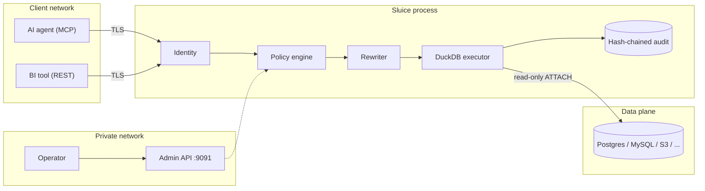

<!-- SPDX-License-Identifier: CC-BY-4.0 -->

# Threat model

This page lists threats, what Sluice does against each, and what you must do.

## Trust boundaries



REST, MCP over HTTP and admin serve plain HTTP until you set `tls`.

## Threats

| Threat | What Sluice does | What you must do |
|---|---|---|
| A client reads a table that no policy allows, also in a join, subquery or `UNION` | Denies the query: `ACL_DENIED` | Allow only the tables that clients may read |
| A client writes with `INSERT`, `UPDATE`, `DELETE` or `MERGE` | Rejects the statement: `ACL_REJECTED`. Attaches databases `READ_ONLY` | Give Sluice a read-only database user |
| A client sends DDL, `COPY`, `BEGIN`, `ATTACH`, `INSTALL` or `LOAD` | Refuses the statement: `ERR_UNSUPPORTED_SYNTAX`, or `ERR_SYNTAX` for the last three | Nothing |
| A client sends two statements in one request | Refuses the request: `ERR_MULTIPLE_STATEMENTS` | Nothing |
| A client calls a function that reads files or settings, such as `read_csv` or `duckdb_settings` | Runs only functions on its allow list. Others: `ACL_REJECTED` | Nothing |
| A client reads rows of another tenant | A `RowFilterPolicy` filters every read of the table. The filter value is a bound parameter | Write a filter for every tenant table. Keep the filter column in every matched table. Without it, reads fail: `ERR_QUERY_FAILED` |
| A client reads a PII column | A `ColumnMaskPolicy` replaces the values of the column | Pick the mask type. `partial` shows a prefix. Unsalted `sha256` values can be guessed |
| A client reads policy SQL or bound values with `EXPLAIN` | Refuses `EXPLAIN` on a table with a row filter or column mask: `ERR_UNSUPPORTED_SYNTAX` | Nothing |
| A client reads bound values with `$n` parameters | Refuses the statement: `ERR_UNSUPPORTED_SYNTAX` | Nothing |
| A client gets around a policy with SQL that Sluice and DuckDB read differently | Rejects a two-part table name such as `shop.customers`: `ACL_REJECTED`. Refuses a name over 63 bytes. Before a rewrite, checks that DuckDB reads the SQL the same way: `ERR_UNSUPPORTED_SYNTAX` or `ERR_SYNTAX` | Write `catalog.schema.table` |
| A client dumps a table in one query | A `QueryRewritePolicy` sets a row limit, a sample and a timeout. `limits.maxRowsCeiling` caps the rows of every result, `limits.maxResultBytes` its size, also for one `list()` or `string_agg()` row that holds a whole table. DuckDB still builds that row in memory | Add a `QueryRewritePolicy` on `tables: ["**"]` |
| A client dumps a table over many queries | Daily budget per subject on result rows and run time: `ERR_BUDGET_EXCEEDED`. The query that crosses the budget is still served | Set `budget.enabled: true`. Set `budget` on the subject binding, with `claims.subjectId` or `issuer` |
| A client floods Sluice with requests | On the REST and MCP listeners, global and per-IP rate limits before login, with one budget for both. One rate limit per subject after login: `ERR_RATE_LIMITED` | Set `rateLimit` on the subject binding, with `claims.subjectId` or `issuer`. `limits.perIpRps` is off by default. Behind a proxy all clients have one address |
| A client sends a risky query form | A `QueryRejectPolicy` rule rejects it: `ACL_REJECTED` | Write the rules |
| A client runs a sensitive query that nobody approved | An `ApprovalPolicy` holds the query until an approver accepts it: `ERR_APPROVAL_PENDING`. A grant runs the same query once. Accept and reject links need only their token | Set `approval.publicBaseUrl` and a webhook. Keep the webhook channel private. Run one instance |
| A stolen API key | Stores only an HMAC of each key with a [pepper](../reference/glossary.md). Rate limit and budget, when set, cap its use | Keep the pepper secret. Use one key id per client. [Rotate keys](key-rotation.md) |
| A forged JWT | Checks signature, algorithm and issuer, and the audience when set. Refuses `alg: none` | Set `issuer`, `audience` and `jwksUrl` |
| A changed audit log | [Hash chain](../reference/glossary.md). `sluice audit verify` exits with status 4 and names file and line. Without a chain key it misses a change when the later hashes were computed again. It always misses removed newest records | Set `audit.chainKeyRef`. Run verify with [`--anchor`](../reference/glossary.md) on a schedule. Keep a copy and each `last_hash` on another host and compare, see [Audit log](audit.md) |
| A query without an audit record | `audit.failClosed`: `ERR_AUDIT_UNAVAILABLE` when the audit queue does not take the record. A failed disk write does not stop queries | Keep it `true`. Alert on `sluice_audit_write_errors_total` |
| An open admin API | Own listener, off by default, bearer token | Set `admin.token` in the server config. Bind `admin.listen` to a private interface |
| Traffic read on the network | TLS and client certificates on the REST, MCP and admin listeners, TLS 1.2 or newer | Set `rest.tls`, `mcp.tls` and `admin.tls`, or use a TLS proxy |
| A secret file open to other users | Refuses a file that group or others can write. Warns when others can read it | `chmod 0600` |
| DuckDB reads local files or other URLs | Turns off external access and extension install, locks the settings. Only the configured S3 bucket and HTTP URLs stay readable | List only the URLs you need |
| A user with database credentials | Nothing. This user does not pass through Sluice | Give database credentials only to Sluice |
| A person who controls the host | Nothing. This person can read every secret and change policies | Protect the host |
| The holder of the admin token | Nothing. The admin API shows policies and audit records | Give the token to operators only |
| A subject learns about one person from many counts and sums | Nothing | Allow such subjects only tables without personal data |

In most rows, a statement that no allow policy matches gets `ACL_DENIED` instead of the row's code. With `resources` in every allow policy, this covers `BEGIN`, `ATTACH`, `INSTALL`, `LOAD` and most DDL.

## Example

One policy allows the table `customers`. A column mask covers `customers.email`. The client asks for a table that no policy allows:

```bash
--8<-- "examples/threat-model/steps/01-table-not-allowed.sh"
```

```json
--8<-- "examples/threat-model/expected/01-table-not-allowed.txt"
```

The client sends a write:

```bash
--8<-- "examples/threat-model/steps/02-write.sh"
```

```json
--8<-- "examples/threat-model/expected/02-write.txt"
```

The client sends `EXPLAIN` on the masked table:

```bash
--8<-- "examples/threat-model/steps/04-explain.sh"
```

```json
--8<-- "examples/threat-model/expected/04-explain.txt"
```

What happened: Sluice refused each statement before it reached DuckDB.

## Limits

- Sluice does not control what a client does with the rows it reads.
- `EXPLAIN` on a table without a row filter or column mask is served. The plan can show the file path of a data source.
- `rowsPerDay` counts result rows too.

## See also

- [Hardening](hardening.md)
- [Audit log](audit.md)
- [SQL forms refused on filtered or masked tables](../policies/row-filters.md#sql-forms-refused-on-filtered-or-masked-tables)
- [Error codes](../reference/error-codes.md)
